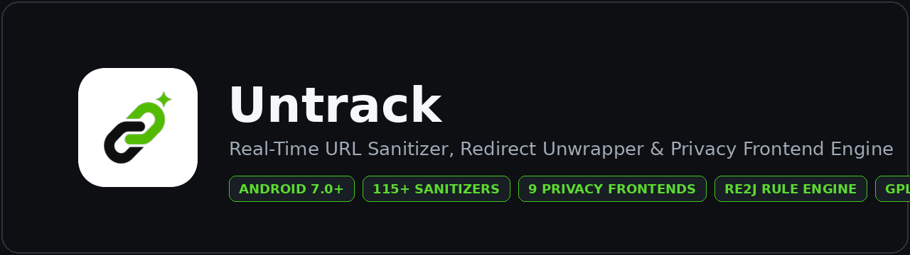

<div align="center">



<br/>
<br/>

[](https://github.com/xboyrex/Untrack/releases/latest)
[-282828?style=flat-square)](https://github.com/xboyrex/Untrack/releases/latest)
[](https://github.com/xboyrex/Untrack)
[](LICENSE)

<p align="center">
  <a href="https://github.com/xboyrex/Untrack/releases/latest"><strong>Download Latest APK</strong></a>
  &nbsp;&middot;&nbsp;
  <a href="https://github.com/xboyrex/Untrack/actions"><strong>CI Build Status</strong></a>
  &nbsp;&middot;&nbsp;
  <a href="https://t.me/MayankDroid7"><strong>Telegram Channel</strong></a>
</p>

</div>

---

## Index

1. [Overview](#overview)
2. [Core Capabilities](#core-capabilities)
3. [Processing Architecture](#processing-architecture)
4. [Supported Privacy Frontends](#supported-privacy-frontends)
5. [System Integration](#system-integration)
6. [Building from Source](#building-from-source)
7. [Maintainer](#maintainer)
8. [License](#license)

---

## Overview

**Untrack** is a real-time URL sanitizer, redirect unwrapper, and privacy frontend router for Android. It strips tracking parameters, affiliate tags, click identifiers, and intermediate redirect wrappers locally on-device while optionally rewriting social media links to privacy-friendly web readers or rich-media embed domains.

---

## Core Capabilities

| Module | Specification |
| :--- | :--- |
| **Real-Time Sanitizer Engine** | Evaluates URLs as you type or paste across **115+ built-in domain and global rule definitions** (`utm_*`, `fbclid`, `gclid`, `gad_*`, `msclkid`, `ttclid`, `igsh`, `si`, `mkt_*`, `sfmc_*`, `at_*`, `wt_*`, `spm`, and platform-specific trackers). |
| **Offline Redirect Extraction** | Unwraps target URLs embedded inside redirect gateways (`google.com/url`, `l.facebook.com`, `l.instagram.com`, `out.reddit.com`, `youtube.com/redirect`, `go.bsky.app/redirect`, `linkedin.com/safety/go`, `click.redditmail.com`, `target.georiot.com`, `click.linksynergy.com`) without network calls. |
| **Hop-by-Hop Shortlink Resolver** | Resolves shortened links (`amzn.to`, `a.co`, `vm.tiktok.com`, `vt.tiktok.com`, `redd.it`, `share.google`, `maps.app.goo.gl`, `fkrt.it`, `myntr.it`, `bit.ly`, `tinyurl.com`, `t.co`, `rb.gy`, `is.gd`, `cutt.ly`) by reading HTTP `Location` headers without loading destination pages. |
| **Interactive Parameter Inspector** | Displays every removed and surviving query parameter per link. Individual parameters can be toggled on or off and remembered per domain. |
| **RE2J Custom Rules & Inference** | Supports user-defined rules across `PRE_CLEAN`, `POST_CLEAN`, and `POST_CONVERSION` phases, plus automatic **Teach-by-Example** rule generation from a before/after URL pair. |
| **Private Link Guard** | Audits links locally for embedded credentials (`user:pass@`), email addresses, JWT bearer tokens, sensitive session keys, and high-precision GPS coordinates with one-tap redaction. |
| **Liquid Glass Interface & OTA** | Built with AGSL refractive glass shaders, rounded typography, AMOLED dark mode, 30+ localized languages, and an in-app GitHub Releases updater. |

---

## Processing Architecture

Every input text or shared intent passes through an 8-stage deterministic pipeline:

```text
Input Text / Shared Intent
  │
  ├── 1. Hop-by-Hop Shortlink Resolution (HTTP 3xx Location headers only)
  ├── 2. PRE_CLEAN Custom Rules (User-defined RE2J rules)
  ├── 3. Multi-Pass Built-in Sanitization (Core Catalog + Deep Platform Cleaners)
  ├── 4. Per-Site Parameter Memory & Interactive Overrides
  ├── 5. POST_CLEAN Custom Rules
  ├── 6. Bidirectional Privacy Frontend & Rich Embed Conversion
  ├── 7. POST_CONVERSION Custom Rules & Component-Aware Percent Decoding
  └── 8. Private Link Guard Security Audit
```

---

## Supported Privacy Frontends

Untrack supports bidirectional host and path conversion across **9 platforms** and **32 built-in targets**, plus unlimited user-defined custom proxy domains:

| Platform | Source Domains | Built-in Embed & Privacy Reader Targets |
| :--- | :--- | :--- |
| **X / Twitter** | `x.com`, `twitter.com` | `fixupx.com`, `fxtwitter.com`, `vxtwitter.com`, `xcancel.com`, `nitter.net`, `twitterviewer.net`, `nitter.catsarch.com`, `nitter.tiekoetter.com`, `nitter.kareem.one`, `nitter.privacyredirect.com`, `nuku.trabun.org`, `twiiit.com`, `farside.link/nitter` |
| **Instagram** | `instagram.com` | `toinstagram.com`, `adamlikes.men`, `instagram7.com`, `kittygr.am`, `kg.meowing.de`, `kittygram.kareem.one` |
| **TikTok** | `tiktok.com` | `tnktok.com`, `tfxktok.com`, `tiktokez.com`, `kktiktok.com` |
| **Reddit** | `reddit.com`, `redd.it` | `redlib.catsarch.com`, `redlib.privacyredirect.com`, `redlib.nadeko.net`, `redlib.privadency.com`, `safereddit.com`, `red.artemislena.eu`, `redlib.r4fo.com`, `redlib.cow.rip`, `old.reddit.com` |
| **Bluesky** | `bsky.app` | `fxbsky.app`, `skylib.coffee`, `skylib.catsarch.com` |
| **YouTube** | `youtube.com`, `youtu.be` | `inv.nadeko.net`, `invidious.nerdvpn.de` |
| **Threads** | `threads.net`, `threads.com` | `shoelace.mint.lgbt` |
| **Pinterest** | `pinterest.com` | `pinterest.bunk.im` |
| **Facebook** | `facebook.com`, `fb.com` | Deep parameter & link-shim sanitization + custom proxy routing |

---

## System Integration

- **Android Share Target (`ACTION_SEND`)**: Share links from any application to **Untrack** to clean and copy, re-share, or open immediately.
- **Text Selection Toolbar (`ACTION_PROCESS_TEXT`)**: Highlight any URL inside any app and select **Untrack Link** from the floating context menu.
- **Browser Link Shield (`APP_BROWSER` Alias)**: Optional system browser interceptor that sanitizes links clicked in third-party apps before handing them off to Chrome Custom Tabs or your default browser.
- **Automation Intent (`com.xboyrex.untrack.ACTION_CLEAN`)**: Programmatic intent endpoint for Tasker, MacroDroid, and scripts.

---

## Building from Source

### Prerequisites
- JDK 21 (Temurin recommended)
- Android SDK (API 36 / 37)

### Assemble Signed Release APK
```bash
chmod +x gradlew
./gradlew :app:assembleRelease
```

The compiled release package is generated at:
```text
app/build/outputs/apk/release/app-release.apk
```

---

## Maintainer

Developed and maintained by **Mayank (`@xboyrex`)**

| Channel | Link |
| :--- | :--- |
| **GitHub** | [github.com/xboyrex](https://github.com/xboyrex) |
| **Telegram** | [t.me/MayankDroid7](https://t.me/MayankDroid7) &middot; [t.me/OnyxHub7](https://t.me/OnyxHub7) |
| **Instagram** | [instagram.com/mayank.zx7](https://www.instagram.com/mayank.zx7) |
| **YouTube** | [youtube.com/@mayankdroid](https://youtube.com/@mayankdroid) |

---

## License

This project is licensed under the [GNU General Public License v3.0](LICENSE).
